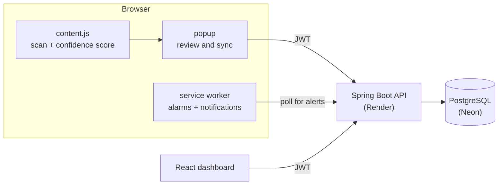

# Artist Commission Tracker

A Chrome extension, web dashboard and REST API that help freelance artists keep track of commissions that arrive through Vgen, X/Twitter and Discord.

Select a client's message, click **Scan this page**, review the suggested price and deadline, and sync it to your tracker. A dashboard keeps everything in one place, and desktop notifications warn you before a deadline.

[Live dashboard](https://commission-tracker-dashboard.onrender.com) · [Chrome Web Store](#) *(add the link once approved)* · [Privacy policy](https://commission-tracker-dashboard.onrender.com/privacy.html)


## What it is

- A **Manifest V3 extension** that reads the text you select on Vgen, X/Twitter or Discord and drafts a commission (price, deadline, platform, link).
- A **review-before-save form**: nothing is stored until you check and confirm it.
- A **React dashboard** to sort by nearest deadline or highest price, filter by status, change a deadline, and jump back to the source.
- **Deadline alerts**: a desktop notification for each active commission due within 24 hours, on a schedule you choose (every 15, 30 or 60 minutes, once a day, or off).
- A **Spring Boot API** with accounts, so each artist only ever sees their own commissions.

## What it is not

- **Not affiliated** with, endorsed by or connected to Vgen, X (Twitter) or Discord.
- **Not a background scraper.** The extension reads a page only when you click **Scan this page**. It does not send messages or post or act on your behalf.
- **Not an invoicing, payment or contract tool.** It stores a title, a price, a deadline and a status.
- **Not guaranteed to be right.** Price and deadline detection is a heuristic (keywords plus patterns). Always check the form before syncing.
- **Not built for scale.** It runs on free hosting, so the first request after a quiet period can take a minute or two.

## How it works



1. **Scan.** The content script scores the selected text: a commission keyword gates everything, then a price (+30) and a deadline (+30) raise the confidence. Nothing leaves the browser at this point.
2. **Review and sync.** The popup shows the draft. When you confirm, it sends the title, budget, deadline, platform, link and status to the API.
3. **Alerts.** When the extension polls, the API checks that user's active commissions and creates a notification for any due within 24 hours. The service worker shows it and acknowledges it. Clicking it opens (or focuses) the dashboard.

## Tech stack

| Part | Technology |
|---|---|
| Extension | Chrome Manifest V3, JavaScript, `chrome.alarms` / `notifications` / `storage` |
| API | Java 17, Spring Boot 4, Spring Security (JWT), Spring Data JPA / Hibernate, Bean Validation |
| Database | PostgreSQL 15+ with `JSONB` metadata |
| Dashboard | React, Vite, Tailwind CSS |
| Packaging | Docker (multi-stage build), Docker Compose |
| Hosting | Render (API and dashboard), Neon (database) |
| Tests | JUnit 5, Node.js test runner, PowerShell end-to-end script |

## Design decisions worth reading

- **Review before sync.** A real chat exposed a heuristic miss: a `$20` tip was picked up instead of the `$112` total. The scorer now prefers a "total" cue, and every scan goes through an editable form.
- **Alerts survive a sleeping server.** Free hosts sleep when idle, so a cron job is unreliable. The API scans a user's commissions when their extension polls. The scheduled job still exists and can be switched off with `APP_NOTIFICATIONS_SCAN_CRON=-`.
- **One error shape.** Every failure is `{ "status", "message", "fields" }`, including 401s from the security filter and Spring's own 404/405 errors.
- **Origin-restricted CORS.** Only the dashboard's origin and the extension's `chrome-extension://<id>` may call the API from a browser. Requests the extension makes also carry an `Origin` header, so its ID must be on the list.
- **Safer defaults.** Production refuses to start without `JWT_SECRET`, there is no default user, login is limited to 10 attempts per email per 15 minutes, and sign-ups to 30 per IP per hour.
- **Duplicates.** A commission is unique per user and source link. On Discord, where every message in a chat shares one URL, a short fingerprint of the selected text is added to the link.

## API

| Method | Path | Purpose |
|---|---|---|
| POST | `/api/auth/register` | Create an account, returns a JWT |
| POST | `/api/auth/login` | Log in, returns a JWT |
| GET | `/api/commissions?sort=deadline\|budget&status=` | List your commissions |
| POST | `/api/commissions` | Save a commission |
| PATCH | `/api/commissions/{id}/status` | Change status |
| PATCH | `/api/commissions/{id}/deadline` | Change or remove the deadline (re-arms the alert) |
| GET | `/api/notifications/unread` | Alerts that are due |
| POST | `/api/notifications/read` | Acknowledge alerts |

## Run it yourself

Commands are for PowerShell. You need Docker Desktop, Node 20+ and JDK 17 (for tests).

```powershell
copy .env.example .env          # set DB_PASSWORD and JWT_SECRET (a long random string)
docker compose up -d --build    # database + API on http://localhost:8080
cd frontend; npm install; npm run dev    # dashboard on http://localhost:5173
```

Extension: edit `extension/config.js` to `http://localhost:8080/api` and `http://localhost:5173`, add `"http://localhost:8080/*"` to `host_permissions` in `manifest.json`, then load the `extension/` folder with **Load unpacked** (Developer mode). Add the extension's ID to `.env` as `CORS_ORIGINS=http://localhost:5173,chrome-extension://<id>` and restart the stack.

## Tests

```powershell
cd backend; .\mvnw test                        # 13 JUnit tests (needs the database running)
cd extension; node --test test/content.test.js test/background.test.js    # 31 tests
cd backend; .\api-check.ps1                    # 37-check end-to-end suite
# against a deployed server:
.\api-check.ps1 -base https://YOUR-API/api -origin https://YOUR-DASHBOARD -extOrigin chrome-extension://YOUR-ID
```

## Deploying

- **Database:** a Neon project; use the direct (non-pooled) connection.
- **API:** a Render web service from `backend/` using the Dockerfile, with `SPRING_PROFILES_ACTIVE=prod`, `JWT_SECRET`, `SPRING_DATASOURCE_URL` / `_USERNAME` / `_PASSWORD`, `APP_NOTIFICATIONS_SCAN_CRON=-`, `PORT=8080` and `APP_CORS_ALLOWED_ORIGINS` (the dashboard origin and `chrome-extension://<id>`, comma-separated).
- **Dashboard:** a Render static site from `frontend/` (`npm install && npm run build`, publish `dist`) with `VITE_API_URL` set to the API's address (no trailing slash).

## Privacy

The text you select is analysed in your browser and never uploaded. Only the title, budget, deadline, platform, link, status and a confidence score are saved, after you confirm. Full details: [privacy policy](https://commission-tracker-dashboard.onrender.com/privacy.html).

## Known limitations

- US dollars only, and dates must follow a cue such as "due" or "by".
- Discord's page structure can change; if the chat panel is not found, select the text you want scanned.
- No password reset or account-deletion screen yet (deletion is by email).
- Free-tier hosting: slow first request after idle; limited storage.
- The dashboard has no automated UI tests.

## License

[LICENSE]. Third-party names are used only to describe compatibility.

Contact: CommishTracker@proton.me